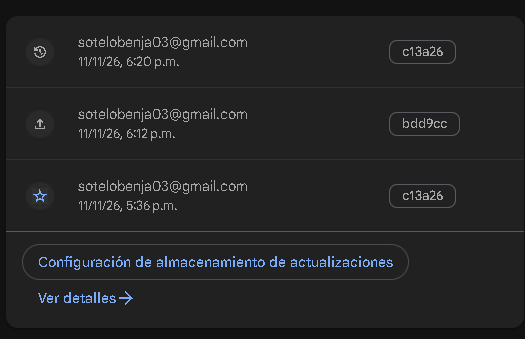
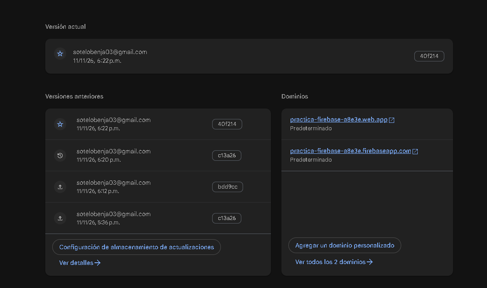
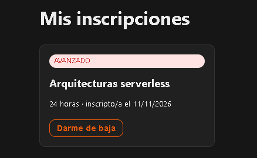

# Evidencias de la práctica

## Rollback aplicado

La versión activa volvió a `c13a26` (la versión anterior a `bdd9cc`).



## Versión republicada después del rollback

Después de verificar el rollback, se volvió a desplegar la versión más reciente disponible en ese momento (`40f214`).



## Validación de producción

Comando ejecutado después del despliegue:

```text
node scripts/check-headers.mjs https://practica-firebase-a8e3e.web.app
```

Resultado observado:

```text
▶ HTML: https://practica-firebase-a8e3e.web.app/
  status 200
  ✔ content-security-policy
  ✔ strict-transport-security
  ✔ x-content-type-options: nosniff
  ✔ x-frame-options: DENY
  ✔ referrer-policy: strict-origin-when-cross-origin
  ✔ permissions-policy: camera=(), microphone=(), geolocation=()
  · cache-control: no-cache, no-store, must-revalidate

▶ Asset estático: /_next/static/chunks/1x6obpmlu1_c2.js
  ✔ cache-control: public, max-age=31536000, immutable

✅ Todos los controles pasaron.
```

Esta comprobación corresponde a una versión anterior con 6 cursos. La versión actual de producción muestra 7 cursos; ver la sección de SQL Connect en producción.

## Validación local de SQL Connect y seguridad

Pruebas realizadas localmente:

1. Se iniciaron los emuladores con `npm run emulators`. Auth quedó disponible en `127.0.0.1:9099` y SQL Connect en `127.0.0.1:9399`. Como el puerto PostgreSQL `5432` ya estaba ocupado, el emulador usó `5433`; esto no impidió el inicio.
2. Se ejecutó `npm run seed`. La operación terminó sin errores y cargó 7 cursos y 2 alumnos ficticios.
3. La aplicación se compiló con `npm run build`; Next.js generó correctamente las rutas estáticas `/`, `/cursos` y `/mis-inscripciones`.
4. Se ejecutó `npm run atacar`. Resultado: `Todos los controles pasaron`. Se comprobó que `ListCursos` es público, `ListAlumnos` está bloqueado para clientes, la inscripción requiere autenticación y es idempotente, y un usuario no puede ver ni borrar la inscripción de otro.
5. Se sirvió el build estático con `node scripts/serve-static.mjs` y se verificó con `node scripts/check-headers.mjs http://127.0.0.1:5000`. Resultado: `Todos los controles pasaron`; se detectaron los headers de seguridad y el caché inmutable de los assets.

## Despliegue de Hosting actual

Se desplegó el sitio estático al proyecto `practica-firebase-a8e3e`:

```text
npx -y firebase-tools@latest deploy --only hosting --project practica-firebase-a8e3e
Deploy complete!
Hosting URL: https://practica-firebase-a8e3e.web.app
```

La verificación de producción se ejecutó con `node scripts/check-headers.mjs https://practica-firebase-a8e3e.web.app` y finalizó con `Todos los controles pasaron` (HTTP 200, headers de seguridad presentes y asset con caché inmutable).

En ese momento el deploy incluía Hosting solamente. SQL Connect se desplegó después, como se registra a continuación.

## SQL Connect en producción

El servicio `catalogo` y el conector `cursos` se desplegaron en `us-east4` el 11 de noviembre de 2026 con `npx -y firebase-tools@latest deploy --only dataconnect --project practica-firebase-a8e3e`. Firebase creó la instancia `catalogo-fdc` bajo la prueba sin costo de SQL Connect.

Se cargaron los datos de ejemplo con `npx -y firebase-tools@latest dataconnect:execute dataconnect/seed_data.gql --project practica-firebase-a8e3e --non-interactive`; la operación terminó sin errores y creó 7 cursos y 2 alumnos ficticios.

La URL de producción `/cursos` respondió correctamente desde SQL Connect y mostró `7 de 7 cursos`. También se verificó el registro e inscripción con una cuenta de Firebase Authentication:



## Evidencia del flujo de Pull Request y preview

- [PR #1 mergeado](https://github.com/sotelobenja/practica-firebase/pull/1).
- [Comentario automático del bot con la URL de preview](https://github.com/sotelobenja/practica-firebase/pull/1#issuecomment-6805834541).
- [Preview del PR #1](https://practica-firebase-a8e3e--pr1-feat-firebase-cicd-u04qt31f.web.app), con vencimiento indicado por el bot: 14 de noviembre de 2026, 20:11 UTC.
- [Ejecución exitosa del workflow de preview](https://github.com/sotelobenja/practica-firebase/actions/runs/43094020971/job/130778103111).
- [PR #2 mergeado](https://github.com/sotelobenja/practica-firebase/pull/2), que elimina la imagen de portada que fallaba.
- [PR #3 de esta entrega](https://github.com/sotelobenja/practica-firebase/pull/3), mergeado el 11 de noviembre de 2026; el commit de merge en `main` es `823f7b2`.
- [Comentario automático del bot con la preview del PR #3](https://github.com/sotelobenja/practica-firebase/pull/3#issuecomment-6809934803).
- [Preview del PR #3](https://practica-firebase-a8e3e--pr3-feat-complete-sql-co-64yl41qk.web.app), válida hasta el 14 de noviembre de 2026, 23:45:18 UTC; se verificó que muestra los 7 cursos.
- [Checks exitosos de build y deploy preview del PR #3](https://github.com/sotelobenja/practica-firebase/actions/runs/43122152069).
- [Deploy a producción tras mergear el PR #3](https://github.com/sotelobenja/practica-firebase/actions/runs/43122700566), finalizado exitosamente. La versión `823f7b2` de `main` quedó publicada y se verificó que `/cursos` muestra `7 de 7 cursos`.
